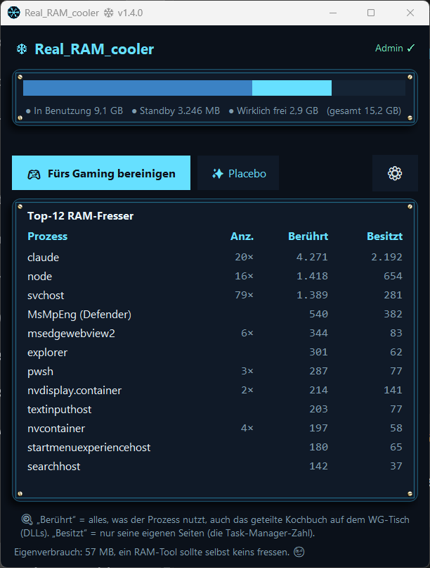

# Real_RAM_cooler ❄

🇬🇧 **[English version → README.md](README.md)**

**Ein ehrliches RAM-Tool für Windows.** Leert die Standby-Liste mit demselben Mechanismus wie RAMMap und ISLC, das Einzige, was gegen Gaming-Stutter durch vollgelaufenen Speicher-Cache wirklich hilft. Kein Zauber, kein „Boost“, keine Versprechen, die Windows nicht halten kann.

    



---

## Was es macht und was nicht

| | |
|---|---|
| 🎮 **Fürs Gaming bereinigen** | Leert die Windows-Standby-Liste über die native API (`NtSetSystemInformation`). Das ist der echte ISLC/RAMMap-Mechanismus: Er hilft real gegen Mikroruckler, wenn sich der Standby-Cache nach langen Sessions aufgebläht hat. |
| ✨ **Placebo-Modus** | Trimmt Working-Sets aller Prozesse. Macht die Zahlen im Task-Manager hübsch, den PC **nicht** schneller: Windows schiebt alles in Memory Compression und holt es zurück. Ist als Gag eingebaut und ehrlich beschriftet, weil 95 % der „RAM-Booster“ da draußen genau *das* als Feature verkaufen. |
| ❄ **Automatik (ISLC-Stil)** | Optional: leert automatisch, wenn Standby-Liste **und** freier RAM konfigurierbare Schwellwerte reißen. Standardmäßig aus, die App macht nichts ungefragt. |

## Features

- **14 Sprachen (seit v1.3):** Deutsch, Englisch, Spanisch, Französisch, Italienisch, Niederländisch, Polnisch, Portugiesisch, Türkisch, Russisch, Hindi, Chinesisch, Japanisch und Koreanisch; startet automatisch in deiner Windows-Sprache, umschaltbar in den Einstellungen
- **RAM-Balken**, der die Wahrheit zeigt: In Benutzung / Standby / *wirklich* frei, nicht das schwammige „verfügbar“
- **Top-12-Fresser-Liste mit zwei Spalten:** „Berührt“ (Working Set inkl. geteilter DLLs) vs. „Besitzt“ (privates Working Set, die Task-Manager-Zahl). Einmal verstehen, nie wieder wundern
- **Vorher/Nachher** bei jeder Bereinigung: `Standby: 1.240 MB → 85 MB ✓`
- **Tray-App:** Rechtsklick aufs Schneeflocken-Icon → bereinigen, ohne ein Fenster zu öffnen
- **Optionales Mini-Overlay** (halbtransparent, ziehbar) mit Live-Werten
- **Autostart** über die Aufgabenplanung, ohne UAC-Abfrage bei jedem Hochfahren
- **Eigenverbrauch rund 10 bis 15 MB:** Ein RAM-Tool sollte selbst keins fressen

## Installation

1. Neueste `Real_RAM_cooler_v….zip` aus den [Releases](../../releases/latest) laden und entpacken. Darin liegen `Real_RAM_cooler_Setup_v….exe` und eine kurze `README.txt`.
2. Setup ausführen → durchklicken → fertig. Das Setup ist dunkel, duzt dich und spricht dieselben 14 Sprachen wie die App.

> **⚠️ „Unbekannter Herausgeber“ / SmartScreen?** Normal. Die App ist nicht code-signiert (Zertifikate kosten mehrere hundert Euro pro Jahr, das zahlt kein Open-Source-Hobbyprojekt). Der Quellcode liegt komplett offen in diesem Repo, du kannst jede Zeile lesen und die App selbst bauen. Bei der Warnung: **„Weitere Informationen“ → „Trotzdem ausführen“**.

> **🛡️ Admin-Rechte?** Ja, bei jedem Start (ein UAC-Klick). Windows erlaubt das Leeren der Standby-Liste nur mit Admin-Rechten, dieselbe Anforderung wie bei RAMMap und ISLC. Ohne geht’s technisch nicht.

## Für Gamer: der 30-Sekunden-Guide 🎮

1. **Vor dem Zocken:** Rechtsklick auf die Schneeflocke im Tray → **„🎮 Fürs Gaming bereinigen“**. Fertig.
2. **Bei langen Sessions** (oder wenn’s nach 2 bis 3 Stunden ruckelt): In den Einstellungen die **Automatik** aktivieren. Empfohlene Werte für 16 GB RAM: leeren, wenn Standby > 1024 MB und frei < 1536 MB. Bei 32 GB kannst du beide Werte verdoppeln.
3. **Kein Overlay im Spiel nötig:** Die App arbeitet unsichtbar im Tray und frisst selbst fast nichts.
4. **Ehrliche Erwartung:** Das Tool behebt Stutter durch vollgelaufenen Standby-Cache. Es macht keine FPS aus dünner Luft, übertaktet nichts und ersetzt kein RAM-Upgrade. Wer dir das verspricht, verkauft dir den Placebo-Button als Hauptfeature. 😉

## Konfiguration

Alle Einstellungen liegen in der `config.json` neben der `.exe` (bei Installation: `C:\Program Files\Real_RAM_cooler\`). Über das ⚙-Menü einstellbar; zwei Werte sind auch per Datei änderbar:

```json
"overlay_alpha": 0.28,
"language": "auto"
```

`overlay_alpha`: Deckkraft des Overlays, `0.15` = Geist 👻, `1.0` = deckend. `language`: `"auto"` (Windows-Sprache) oder ein Sprachkürzel wie `"de"`, `"en"`, `"es"`, `"ja"`. App neu starten, fertig.

## Selbst bauen (Open Source!)

```powershell
pip install pystray pillow
python real_ram_cooler.py --make-icon                    # erzeugt icon.ico
python -m PyInstaller --onefile --noconsole --uac-admin --icon icon.ico --name Real_RAM_cooler real_ram_cooler.py
```

Installer bauen: `setup.iss` mit [Inno Setup 6](https://jrsoftware.org/isinfo.php) kompilieren (Strg+F9).

## FAQ

**Warum zeigt der Task-Manager andere Zahlen als die Spalte „Berührt“?**
Der Task-Manager zeigt das *private* Working Set (nur eigene Seiten), „Berührt“ zählt auch geteilte DLLs mit. Beide Zahlen stimmen, sie beantworten verschiedene Fragen. Die App zeigt deshalb beide.

**Nach dem Placebo-Button ist `Memory Compression` riesig. Bug?**
Feature. Genau das passiert mit „getrimmtem“ Speicher: Windows komprimiert ihn, statt ihn freizugeben. Der Button existiert, um das live zu demonstrieren.

**Windows Defender mag die frisch gebaute .exe nicht?**
Frische, unsignierte PyInstaller-Exes werden gern als False Positive geflaggt. Beim Selbstbauen: Projektordner vorher als Defender-Ausnahme eintragen.

**Funktioniert das auch mit 8 GB / 32 GB / 64 GB RAM?**
Ja. Die Schwellwerte der Automatik sind Schieberegler, pass sie an die eigene RAM-Größe an.

## Lizenz

MIT: nutzen, lesen, forken, verbessern. Siehe [LICENSE](LICENSE).

---

*Gebaut in einer Nacht-Session von Dennis ([@Dennismit2n](https://github.com/Dennismit2n)) mit Claude, inklusive Live-Beweis, warum RAM-Booster Schlangenöl sind. Die App ist das Protokoll davon.* ❄💙
